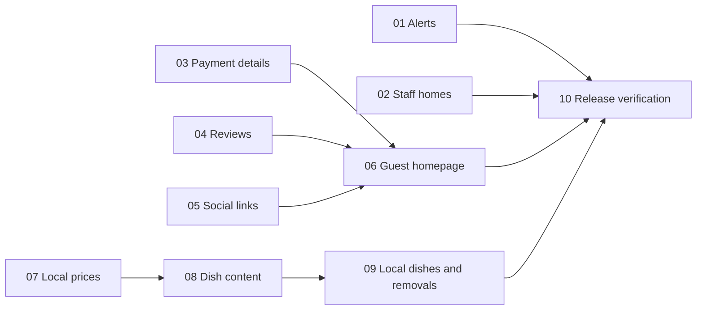

# Venue experience implementation plan

The user confirmed the scope after a twelve-question interview and authorized this specification and ticket set on 2026-11-17. All tickets are unimplemented. `ready-for-agent` means specified and triaged; a ticket with unfinished blockers is not yet executable.

- [Specification](spec.md): behavior, permissions, implementation defaults, tests and exclusions.
- [Decision record](decisions.md): interview answers and deferred video requirements.
- [Venue Menu ADR](../../docs/adr/0007-managers-publish-venue-local-menu-changes.md): shared Brand information with independently published local changes.

## Priority and suggested build order

**P1** is service reliability, clear staff roles and the complete guest homepage. **P2** is the larger Venue Menu expansion, also required for this release. Ticket 10 is the release gate. Numbers give a sensible solo build order; blockers capture only genuine dependencies, not scheduling preferences.

| Order | Priority | Ticket | Blocked by | What it delivers |
| --- | --- | --- | --- | --- |
| 01 | P1 | [Waiter Order alerts](issues/01-verify-waiter-order-alerts.md) | None | Verifies/repairs current foreground and push behavior and prepares the real-phone check. |
| 02 | P1 | [Owner and Manager homes](issues/02-separate-owner-and-manager-homes.md) | None | Distinct role entry points, retained Owner operations and verified Quick add. |
| 03 | P1 | [Public Payment details](issues/03-public-payment-details.md) | None | Guests see active payment instructions before ordering; Owner-only edits remain. |
| 04 | P1 | [Private Reviews page](issues/04-private-feedback-destination.md) | None | Eligible paid guests leave feedback; others get a clear explanation. |
| 05 | P1 | [Brand social links](issues/05-brand-social-links.md) | None | Owner edits once, and all Venues show the same social profiles. |
| 06 | P1 | [Guest homepage and continuation](issues/06-guest-homepage-and-continuation.md) | 03, 04, 05 | Existing Venue Links open four working destinations without losing Drafts/Visits. |
| 07 | P2 | [Publish local prices](issues/07-publish-venue-price-overrides.md) | None | First complete local draft/preview/publish flow, used by guest and Waiter ordering. |
| 08 | P2 | [Publish local dish content](issues/08-publish-venue-dish-content.md) | 07 | Local content/photos/options override only the assigned Venue. |
| 09 | P2 | [Local dishes and removals](issues/09-local-dishes-and-removals.md) | 08 | Add, remove and restore Venue offerings without losing history. |
| 10 | Gate | [Release verification](issues/10-release-verification.md) | 01, 02, 06, 09 | Combined acceptance journey, full checks and actual phone delivery evidence. |

Tickets 03–05 are individually useful through links from the existing Menu. Ticket 06 integrates them into the new homepage; it does not ship placeholder destinations. None of the guest-homepage work depends on tickets 07–09.

## Working a ticket

Start with **01**, then follow the table unless there is a reason to work an independent ticket first. Currently 01, 02, 03, 04, 05 and 07 have no blockers. Choose one ticket per implementation step; each includes the authorization, data changes, UI and checks needed to demonstrate its behavior.

Use the existing public-core tests against the real local database and production-build browser tests. Keep tests focused on external behavior and build isolated scenario data. A completed feature ticket should pass its targeted checks; ticket 10 verifies the assembled release rather than supplying missing per-feature tests.

Read the applicable repository and framework instructions before implementation. Apply modern-web-guidance to actual UI changes then, using the relevant guides. Preserve existing uncommitted changes and do not reset production or alter unrelated v1 issues. Record implementation/validation notes in each ticket's Comments section and check off acceptance criteria as they are actually demonstrated; do not invent a new triage status to mean done.

## Deferred

- **Videos:** support both photos and videos; uploaded video should autoplay with fast loading. External generation/prompts and playback/loading details remain documented in the decision record, with no implementation in these tickets.
- **Reviews for unlinked guest phones after Waiter-only ordering:** needs a later association flow; keep current paid-Visit eligibility now.

Do not mark the release ready without real-phone notification evidence. If the target environment or device is unavailable, keep that release check pending and report the limitation separately from passing automated tests.
